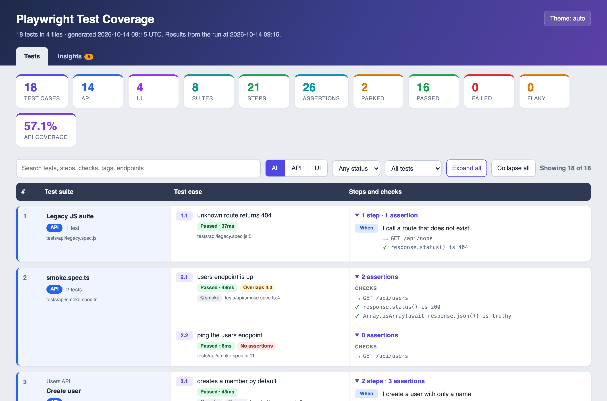
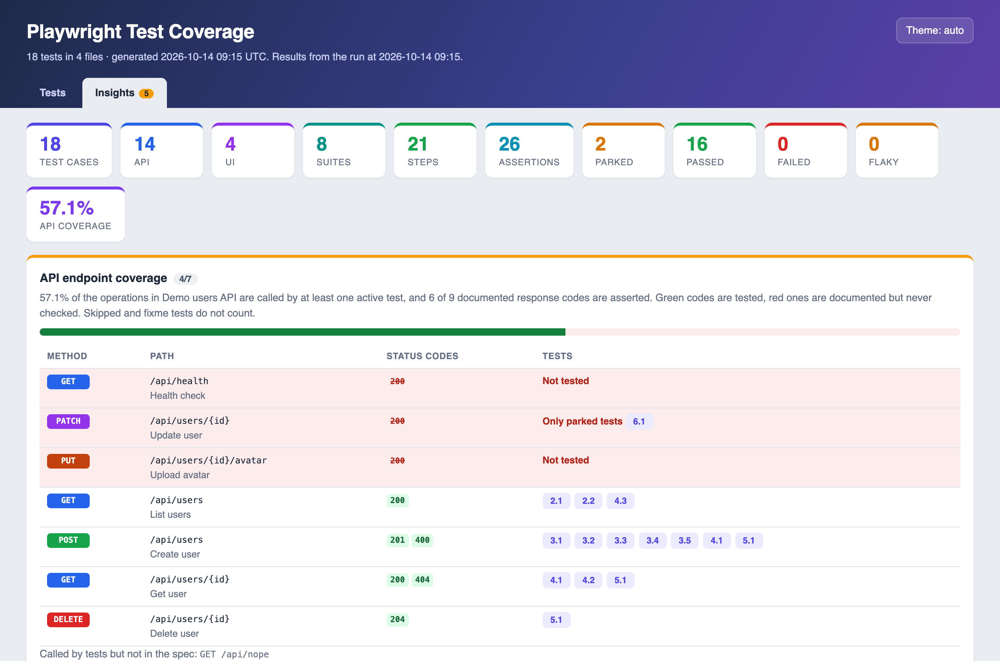

# pw-coverage-map

**See what your Playwright tests cover without running them.**

One command turns your specs into a single, searchable HTML page: suite → test case → steps, with every assertion and HTTP call listed. It also points out what is missing or repeated: API endpoints and status codes with no test, tests that assert nothing, tests that duplicate each other, and skipped tests that have been forgotten.

No AI and no test run are needed. It reads your source code with the TypeScript compiler and uses `playwright test --list` to get the real test names.



```bash
npx pw-coverage-map
# → coverage-map/index.html + coverage-map/coverage.json
```

## What you get

| | |
|---|---|
| **Coverage map** | Every test with its `test.step`s (nested steps included), the `expect()` checks inside each step, HTTP calls and page visits. Tests generated in loops are listed one by one, with `${placeholders}` filled in from the real title. |
| **API endpoint coverage** | Pass `--openapi spec.json` to see which operations have no test, and which documented response codes (201, 400, 404…) are never asserted. Skipped tests don't count as coverage. |
| **Auto-discovered API clients** | `users.createUser(body, 400)` is understood with no config. The tool follows your imports and finds client methods that take an `expectedStatus` parameter and make an HTTP call. |
| **Over-coverage** | Tests in different places that send the same inputs and make the same checks. These are candidates to merge or turn into one data-driven test. |
| **No-assertion tests** | Tests that can pass without checking anything. |
| **Parked register** | Every `test.skip` / `fixme` / `fail`, with the reason written in the code. |
| **Tag matrix** | Tags × test type, so you can see where `@smoke` has no UI tests. |
| **Last-run results** | Pass `--results results.json` (Playwright JSON reporter) to add passed/failed/flaky, durations, error messages and the slowest tests. |
| **CI gates** | Fail the build on low API coverage, tests without assertions, too many parked tests, or a committed report that is out of date. |
| **PR/MR diff** | `pw-coverage-map diff before.json` writes Markdown listing the tests added, removed, changed and newly parked. |
| **Exports** | HTML (one file, works offline), JSON, Markdown and CSV. |



The HTML report has dark mode, works on phones, prints cleanly and links each test to its line on GitHub, GitLab or Bitbucket (detected from your git remote).

## Install

```bash
npm i -D pw-coverage-map
```

Requirements: Node 18.18+ and `@playwright/test` 1.42+ in the project. Works with TypeScript and JavaScript specs.

## CLI

```
npx pw-coverage-map [options]

  -o, --out <dir>              output folder (default: coverage-map)
  -f, --format <list>          html,json,md,csv (default: html,json)
  -t, --title <text>           page title
  -c, --config <file>          config file
      --playwright-config <f>  Playwright config to use
      --project <name>         only these projects (repeatable)
      --grep <regex>           only tests matching
      --results <file>         Playwright JSON report of a real run
      --openapi <file>         OpenAPI / Swagger spec (.json, or .yaml with the "yaml" package)
      --source-url <template>  e.g. https://github.com/org/repo/blob/main/{file}#L{line}
      --summary <file>         append a Markdown summary (e.g. $GITHUB_STEP_SUMMARY)

  CI checks (exit code 1 on failure)
      --check                  committed report is out of date
      --min-api-coverage <pct>
      --fail-on-no-assertions
      --max-parked <n>
      --max-duplicates <n>
      --fail-on-failed

npx pw-coverage-map diff <before.json> [after.json] [--out changes.md]
```

## Config (optional)

Everything works without a config file. Add `pw-coverage-map.config.mjs` only when you need to change something:

```js
import { defineConfig } from "pw-coverage-map";

export default defineConfig({
  title: "Checkout — test coverage",
  openapi: "api/openapi.yaml",
  results: "test-results/results.json",
  env: { CI: "true" },                       // for configs that add projects only on CI
  // Only if auto-discovery can't see your client (e.g. the status is passed in an options object):
  clientMethods: {
    createOrder: { statusArg: 1, defaultStatus: 201, endpoint: "POST /v1/orders" },
  },
  // Your own test types instead of API / UI:
  classify: ({ file }) => (file.includes("/contract/") ? "contract" : file.includes("/api/") ? "api" : "ui"),
  check: { minApiCoverage: 80, noAssertions: true, maxParked: 5 },
});
```

You can also use a `"pwCoverageMap"` key in `package.json`.

## CI recipes

**GitHub Actions**: publish the report and post a summary on every run.

```yaml
- run: npx playwright test --reporter=json,list
  env: { PLAYWRIGHT_JSON_OUTPUT_NAME: results.json }
- run: npx pw-coverage-map --results results.json --openapi openapi.json --summary "$GITHUB_STEP_SUMMARY" --min-api-coverage 70
  if: always()
- uses: actions/upload-artifact@v4
  if: always()
  with: { name: coverage-map, path: coverage-map }
```

**GitLab CI**: serve it on GitLab Pages.

```yaml
pages:
  stage: deploy
  script:
    - npm ci
    - npx pw-coverage-map --out public
  artifacts: { paths: [public] }
```

**MR/PR comment with the test changes**

```bash
git show origin/main:coverage-map/coverage.json > /tmp/before.json   # if you commit the JSON
npx pw-coverage-map diff /tmp/before.json --out changes.md
```

## How it works

1. `playwright test --list --reporter=json` gives the real list of tests: titles (loops expanded), tags, projects, files and lines. Nothing runs: no `globalSetup`, no `webServer`, no browsers.
2. Each spec is parsed with the TypeScript compiler API. Each listed test is matched to its `test()` call by line, and the tool collects its steps, `expect` chains, HTTP calls, `page.goto`s, `beforeEach` hooks and `skip/fixme` reasons. Relative imports are followed (3 levels) to discover API client methods.
3. `${placeholders}` in step titles are filled from the values in the real test title and from literal constants, using a small safe evaluator (no `eval`).

**Limits** (it's static analysis): steps written inside page-object or helper methods are not followed into, a loop *inside* a single test shows as one step with `‹name›`, and values only known at run time stay as placeholders.

## Programmatic API

```js
import { createReport, renderHtml, renderMarkdown } from "pw-coverage-map";

const report = await createReport({ cwd: "path/to/project", openapi: "openapi.json" });
console.log(report.totals, report.insights.endpoints.spec.percent);
```

## Try it on the example

```bash
git clone https://github.com/sree030289/pw-coverage-report.git && cd pw-coverage-report && npm i
npm run example          # static report for example/
npm run example:run      # runs the example suite first, then adds the results
```

## Licence

MIT
